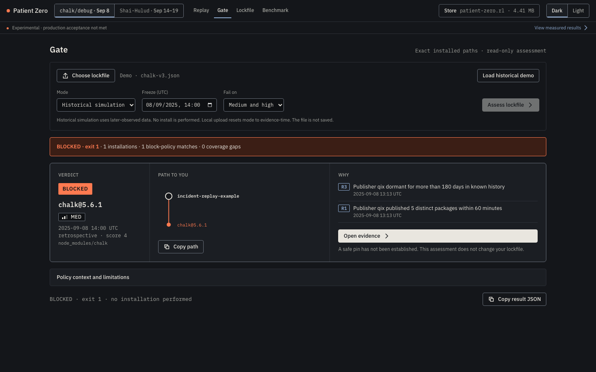

# Patient Zero

A local graph of npm supply-chain incidents, temporal detection signals and exact lockfile exposure paths.

**Held-out retrospective reference recall: 0.00%. Quiet-week alert rate: 659.82 flags per 1,000 known publishes.** [Results and denominators](bench/results.md).

**The current detector does not meet a production gate acceptance standard.** The held-out Shai-Hulud manifests are unavailable: all 516 reported versions lack recovered publisher/script fields, and three lack publication times. Meanwhile coordinated releases trigger many control-week alerts. These results are preserved; advisory labels are never used to manufacture detector inputs or hide counterexamples. First-public-advisory recall and lead time remain unestablished.

Implemented: metadata ingestion, graph schema, R1–R5 detection, exact package-lock v2/v3 parsing, a fail-closed gate CLI, replay/explanations, incident-A-only parameter selection and a held-out/control benchmark. The owner-provided UI, three read-only MCP tools and GitHub Action wrapper are integrated. Treat the gate as an experimental metadata policy tool requiring review, not accepted unattended install assurance.



## Install and verify

Requirements: **Node.js 22+**, npm workspaces and npm optional dependencies enabled. `.nvmrc` selects Node 22. Verified locally on Node 22.23.5 and Node 25.9.0 / npm 11.12.1; Windows has not been separately tested. Relate loads a native optional package for macOS arm64/x64, Linux arm64/x64 or Windows x64. No database server or standalone Relate CLI is required.

From the repository root, in order:

```sh
npm ci
npm run check
npm run demo
```

`demo` prints the native check, historical replay, an intentional fixture block and measured benchmark, then serves the UI at **http://127.0.0.1:3000**. Stop another server on that port first; Ctrl+C stops the demo. No packages from the fixture are installed. `npm run demo:terminal` keeps the terminal-only replay; `npm run demo:check` verifies the demo without starting a server.

Dependency installation needs registry access. After installation, replay, gate assessment, tests, store builds and benchmarking run offline. The workspaces are **private and unpublished**. Use the local CLI below, or `npx --no-install patient-zero` after building. Unqualified `npx patient-zero` may resolve an unrelated npm package.

```sh
npm run pz -- explain chalk@5.6.1 --as-of 2025-09-08T14:00:00Z --mode retrospective
npm run pz -- replay shai-hulud-2025-09 --step-minutes 60
npm run pz -- detect --as-of 2025-09-08T14:00:00Z --json
```

Single-file storage: one artifact per repo that CI can cache, diff and ship; judges open it with the Relate CLI without running anything. Here, diff means reviewing logical metadata/evidence changes; binary serialization is not promised stable.

The root `patient-zero.rl` contains **1,574 version identities** from both incident snapshots. Full Shai-Hulud reference coverage means the deduplicated **516-version / 197-package** union of the pinned StepSecurity and Wiz lists; it does not assert exhaustive worldwide campaign coverage. Missing facts remain unknown.

## Gate usage and exit codes

The gate reads the store and lockfile, never executes lifecycle scripts, never installs dependencies and never fetches network data.

A historical fixture demonstrating a block:

```sh
npm run pz -- gate --lockfile fixtures/lockfiles/chalk-v3.json --as-of 2025-09-08T14:00:00Z --mode retrospective
```

**Expected exit code: 1.** The fixture is metadata for replay; do not install it. `retrospective` is an explicit historical simulation using later-observed facts. Current assessment defaults to `evidence` mode and requires fresh inputs. Compacted benchmark histories cannot authorize an allow; stores need explicit full-available-history coverage markers, and unknown predecessor evidence needed by applicable rules causes exit 2.

| Exit | Meaning |
| --- | --- |
| 0 | No findings meet the selected policy and every installed registry version has required metadata coverage; this is not proof of safety |
| 1 | At least one exact installed dependency path meets the block policy |
| 2 | Invalid/unsupported lockfile or source, missing/unknown/future/stale coverage, missing/incompatible store, or runtime failure; no allow verdict |

A mixed result containing a block and other coverage gaps exits **2**, still preventing installation. Decisive block evidence is not erased by unknown auxiliary fields on the blocked version itself. Raising `--fail-on` cannot turn incomplete metadata into an allow.

Supported: nested and hoisted installs, scopes, npm aliases, peers, absent optional dependencies, root dev dependencies and declared local workspace links. Every installed descriptor must be reachable. Optional registry packages absent from the lock are reported as unassessed/skipped; installed optional descriptors are included regardless of the current machine's platform. Rejects v1, missing required/peer edges, range/identity mismatches, escaping links, bundled artifacts, git/tarball/file sources outside supported local workspaces, private registries and credential-bearing URLs. Resolved public npm URLs must match the locked canonical name and archive version.

Instance paths are retained through taint propagation; duplicate package versions in separate subtrees cannot create invented cross-tree paths. The gate checks metadata, not archive signatures or the truth of a manually edited lockfile's contents. No safe upgrade is inferred.

## Prepare a current project snapshot

The shipped store is incident-focused and cannot cover arbitrary application lockfiles. Missing coverage causes exit 2. For an explicit metadata refresh, run these commands from the tool repository **before installing the application dependencies**:

```sh
npm run build
npm run pz -- ingest-lockfile --lockfile /absolute/path/to/app/package-lock.json --manifest data/cache/app/manifest.json
npm run pz -- build-store --from-cache --manifest data/cache/app/manifest.json --store data/cache/app/patient-zero.rl
npm run pz -- gate --lockfile /absolute/path/to/app/package-lock.json --store data/cache/app/patient-zero.rl --fail-on medium --max-store-age-hours 168 --json
```

Use a new store filename for subsequent builds. Never interpret a nonzero exit as permission to install. The current benchmark results do not justify unattended approval even when a policy assessment completes.

`ingest-lockfile` parses locally first, fetches only public registry metadata for canonical registry package names, and retains a lockfile hash rather than its body or local project names. Unsupported/private sources fail before collection. It does not recover removed manifests by guessing; those versions can remain incomplete. No npm credentials or authentication workarounds are used.

## Build offline stores

Builders verify all normalized-cache and incident checksums, validate package coverage and reconstruct only supported missing facts. A transaction builds a temporary database; publication refuses to overwrite an existing output.

```sh
# Rebuild both incident datasets into a new store.
npm run build:store -- --catalog data/demo.json --store ./combined-rebuilt.rl

# Rebuild only the incident-A snapshot.
npm run build:store -- --store ./chalk-rebuilt.rl
```

`data/demo.json` lists the manifests/catalogs for the combined store. `build-store --manifest` also accepts explicit lockfile snapshot manifests. The builder materializes findings for tuning incidents only; it does not automatically evaluate held-out data. Detect/replay/gate ignore stored findings as inputs.

Relate 1.0.1 has no close API: build and read file stores in separate processes. Logical records are reproducible from pinned inputs; byte-identical native `.rl` serialization is not promised.

## Benchmark and freeze boundary

```sh
# Rerun the existing frozen experiment offline.
npm run bench
```

`bench/spec.json` defines datasets and 15-minute ticks. `bench/frozen-config.json` records the incident-A-only candidate grid, objective, selected profile, training hash and detector-code fingerprint. `npm run bench:tune` creates that file **only when absent** and refuses to overwrite it. The existing profile was frozen before the first held-out/control run. Code/config/training mismatches cause an operational failure, not silent retuning.

Do not delete the frozen profile to optimize these held-out results. A new experiment needs a separately identified training/hold-out split. The frozen search selected the existing defaults: burst 5 packages / 60 minutes, medium 3, high 5, decay 0.7, max 4 hops, weights R1/R2/R3/R4 = 3/2/1/2. `config/detection.json` is the matching CLI profile.

The control cohort contains 2,000 download-ranked packages from a pinned June 2025 list, before the August 1–8 control week. It is not a verified exact August global ranking. The collected metadata contains **438 known publications in that week; 289 were flagged**. The rate assumes the week is benign, rather than independently proving every publish clean.

Event-time rule evaluation is mapped onto 15-minute replay ticks; equivalence to literal replay is tested on synthetic data and the sourced incident-A dataset. Unknown timestamps are reported and excluded from publication-rate denominators. All-reference recall counts missing/unassessable reference identities as misses. OSV publication is a separately named cutoff, never a substitute for verified first public disclosure. See [assessment](bench/ASSESSMENT.md), [results](bench/results.md) and [machine-readable evidence](bench/results.json).

## Environment, config and dependencies

No environment variables, secrets, API keys or `.env` file are required for public npm/OSV collection, the demo, UI, tests or benchmark. CLI `.env` files are **not automatically loaded**; Next uses its normal environment loading rules in `web`. Optional UI settings are documented in [web setup](web/README.md).

| Setting | Behavior |
| --- | --- |
| `PZ_CACHE_DIR` | Optional default output directory for `ingest` / `ingest-lockfile`: contains `manifest.json` and `cache/`; default `./data/cache`. Explicit `--manifest` wins. |
| `PZ_AS_OF` | Optional ISO freeze time for detect/explain/gate; explicit `--as-of` wins. Gate, MCP and Explain otherwise use current UTC. Detect requires a time; Replay uses its incident window. |
| `GITHUB_TOKEN` | Reserved for a future optional GitHub Advisory integration; not consumed |
| `RELATE_LIB` | Upstream native-library override; normally leave unset so npm selects the compatible platform package |

CLI policy keys: `--fail-on medium|high` (default medium), `--max-store-age-hours 168` (evidence mode), `--config config/detection.json`, `--mode evidence|retrospective`. Increasing the age limit weakens freshness requirements; it does not repair coverage or improve detector accuracy.

Pinned runtime dependencies: `@relate/relate@1.0.1`, `zod@4.6.7`, `@streamparser/json@0.0.26`, **`semver@7.8.6`**. Development dependencies: `typescript@7.0.2`, `@types/node@22.20.5`, **`@types/semver@7.8.0`**. Exact versions are in root/workspace package files and `package-lock.json`.

## Data, provenance and refresh order

- [Incident A](data/replay/README.md): 18 reported versions, reconstructed campaign-level publisher attribution, unknown removed-manifest script fields.
- [Shai-Hulud reference and cache](data/shai-hulud/README.md): 516 reported versions; 513 known publication times; zero recovered malicious-version publisher/script states. Three packages return 404. No metadata was imported from a mirror that pointed a removed version at an older archive.
- [Control snapshot](data/control/README.md): all 2,000 selected packages, temporal compaction with publication-predecessor and publisher-history context; 14 malformed historical-field warnings preserved as unknowns.

For a deliberate **new data capture**, build TypeScript first. `scripts/prepare-shai-catalog.mjs` fetches the two primary reports and extracts IOC facts only. `scripts/collect-metadata.mjs --incident <catalog> --manifest <new-output>/manifest.json --start <ISO> --end <ISO>` collects/resumes bounded metadata snapshots at two-request concurrency. Use a new output directory for a fresh capture; existing progress intentionally reuses the pinned capture. `scripts/enrich-shai-labels.mjs` enriches the configured Shai-Hulud reference with exact OSV labels and updates its manifest checksum. Changing any catalog invalidates the old manifest until recollected/repinned; changing training data invalidates the frozen experiment.

The checked-in capture has already completed these steps. Do not run preparation scripts during an ordinary offline build. `scripts/prepare-incidents.mjs` updates **incident A only** and never replaces the full held-out catalog with the former seed.

No archive or incident package code is downloaded or executed. Registry fetches reject redirects, time out at 60 seconds and cap decompressed input at 64 MiB; OSV is bounded/paginated. Large packuments are stream-normalized. Current `maintainers[]` is discarded. Source URLs, observation times, response fingerprints and normalized snapshot checksums preserve provenance. Attestation presence is metadata, not cryptographic verification.

Do not commit user lockfiles or private registry information. Live snapshots/stores under `data/cache/` are ignored; only the reviewed root `.rl` artifact is exempted. Source attribution and cohort license notices are in [bench/sources](bench/sources/NOTICE.md).

## Local UI

The completed owner HTML is integrated into Next.js: Replay, Gate, Lockfile, Explain and Benchmark, with supplied themes/tokens, a Sigma graph and timeline controls. Screens use real backend evidence and measured results. The original gallery sources are preserved in `web/design/`.

After `npm ci`, run `npm run web:dev` and open **http://127.0.0.1:3000**. For production mode: stop dev, run `npm run web:build`, then `npm run web:start`. Both servers bind loopback. No environment variables or secrets are required. Optional server-only `PZ_PROJECT_ROOT` and `PZ_WEB_STORE`, native dependencies, upload limits, restart order and browser tests are documented in [web/README.md](web/README.md).

Uploads remain in memory; no install, safe-pin or ignore action is offered. New uploads default to evidence-time and current UTC. The shipped historical snapshot can return incomplete current assessments. The Benchmark screen preserves the failed acceptance and unknown first-public-advisory timing. Public hosting needs a separate authenticated deployment design. Custom MCP and the Action are implemented; see their setup below.

[Graph/contract details](docs/GRAPH.md), [status](docs/STATUS.md), and the unmodified original [PLAN.md](PLAN.md). The repository retains its original MIT license.


## MCP, CI and release materials

The stdio MCP server provides `blast_radius`, `why_blocked` and `safe_upgrade_path`. It shares the read-only detector/gate, masks later evidence and never invents a safe pin. Supply a fully resolved candidate lockfile for upgrade policy assessment. The separate Relate built-in MCP is also verified in read-only mode. [MCP setup and historical walkthrough](packages/mcp/README.md); reviewable host examples are in `config/mcp*.example.json`. No secret or automatic host configuration is required.

[GitHub Action setup](docs/ACTION.md) documents exact inputs, outputs, trusted evidence boundaries and release-SHA pinning. `.github/workflows/ci.yml` configures backend/native checks, offline frozen benchmarking, production UI tests and a historical Action regression. The completed implementation is published on `main`. Hosted workflow evidence and per-job links are recorded in [docs/CI.md](docs/CI.md). CI verifies implementation behavior; it does not change the failed detector acceptance.

### How the replay data was reconstructed

Surviving per-version npm metadata is combined with exact OSV/primary IOC identities for removed versions. Recovered timestamps and campaign publisher attribution carry per-field report sources and observation times. Unsupported publisher/script fields remain null. Evidence mode hides facts observed after its freeze; retrospective mode explicitly permits later-observed reconstruction. Current `maintainers[]` is never substituted for version publisher history. Source-specific details and rejected recovery are linked in the data sections above.

The emphasis is local temporal replay, exact path-level explanations and a reproducible held-out experiment. [Socket](https://socket.dev/) and [Snyk Open Source](https://snyk.io/product/open-source-security-management/) are established supply-chain/SCA products; this experiment makes no claim to replace or outperform their coverage. The measured limitations remain central to its comparison.

The optional third incident was dropped in favor of two sourced incidents plus control. Original MIT licensing is retained. [Resolved plan decisions](docs/DECISIONS.md), [requirement/evidence audit](docs/COMPLETION.md), [AI and third-party disclosure](THIRD_PARTY_NOTICES.md), and [prepared submission copy](docs/SUBMISSION.md) document the final boundaries. Video/storyboard work is excluded. GitHub publication and hosted CI are handled separately from eligibility/registration and submission, which remain owner actions.
